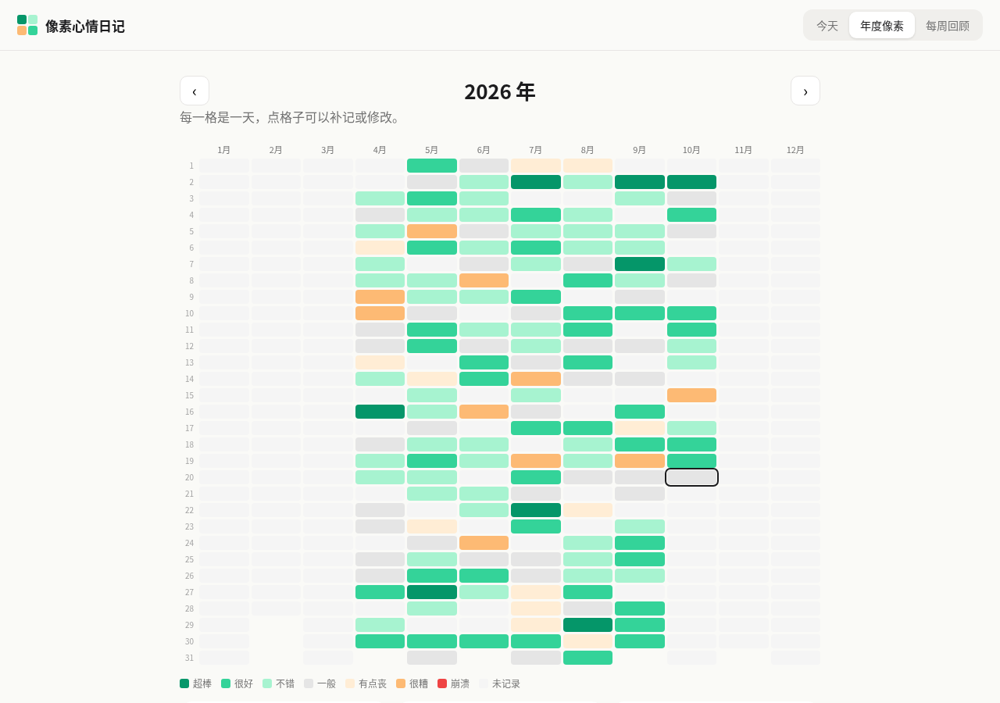

# 像素心情日记 · Pixy 网页版

> 一天一格，一年一张像素画。给大学生和职场新人的轻量情绪日记。

**在线体验：** https://zouyue123321.github.io/pixy-mood-diary/



## 这是什么

基于开源情绪记录 App [Pixy](https://github.com/mrzmyr/pixy-mood-tracker-app) 改编的中文网页版。每天选一个心情颜色、点几个标签，就能在「年度像素图」上点亮一格；「每周回顾」会根据你的记录生成一段小结和建议。数据只存在浏览器 localStorage 里。

网页版代码在 [`web/`](web/) 目录，由 `gh-pages` 分支部署。仓库其余部分是原 Pixy（React Native / Expo）App 的源码，原样保留。

## 目标用户

刚上大学、正在实习或刚入职的年轻人：压力来源多（考试、求职、加班、人际），但很少有时间和习惯去写长篇日记。

## 用户痛点与产品思考

- **记录门槛高** → 一天只记一格：7 档心情颜色 + 场景标签 + 可选一句话（限 140 字），10 秒完成。
- **不知道自己的情绪被什么影响** → 每周回顾对比「有某个标签的日子」和整体平均心情。只有同一标签至少出现 3 次才下结论，避免样本太少乱归因。
- **标签要贴近场景** → 原 App 的标签是用户自建的；网页版预置了上课、考试、实习、求职面试、加班、开会、熬夜、通勤等大学生和新人高频场景，开箱即用。
- **"AI 回顾" 要可信** → 这版不调用大模型，回顾文案由规则生成，并在界面上明确标注「按规则生成」。规则可解释、零成本、不上传数据。后续可以把同样的结构化统计交给大模型润色。
- **情绪安全** → 如果一周里连续 3 天以上是「很糟 / 崩溃」，回顾会换成温和的提示，建议找信任的人或学校 / 公司心理咨询服务聊聊，而不是继续给效率建议。
- **空状态** → 本周记录少于 3 天时不硬凑结论，而是告诉用户还差几天；提供「填入示例数据」按钮（明确标注为示例，可一键清空）方便体验。

## 我改编了什么

- 确认原项目是 React Native + Expo App（依赖大量原生模块、bun 工具链），没有直接用 Expo 导出 web，而是在 `web/` 新增一个零依赖的轻量网页实现
- 延续原设计：7 档心情配色取自原项目默认色阶 `src/constants/colors/scales.ts`（emerald → neutral → orange → red），心情分值 0–6 与原 `RATING_MAPPING` 一致
- 新增：中文界面、场景标签、年度像素图（12 月 × 31 天，点格子可补记）、年度统计、规则生成的每周回顾、示例数据

## 本地运行

```bash
cd web && python3 -m http.server 8000
```

## 致谢

基于 [mrzmyr/pixy-mood-tracker-app](https://github.com/mrzmyr/pixy-mood-tracker-app)（作者 mrzmyr，MIT License）改造。原 LICENSE 见 [LICENSE.md](LICENSE.md)，原 README 见 [README.original.md](README.original.md)。
